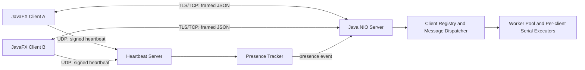

# Secure NIO Chat

A multi-client desktop chat application built to demonstrate Java networking,
TCP and UDP, non-blocking I/O, multithreading, TLS, addressing and naming, and
application-level protocol design.

The project currently provides a working JavaFX chat client, a selector-based
Java NIO server, encrypted TCP messaging, and authenticated UDP presence
heartbeats. Persistence, accounts, file transfer, and profile storage are
planned but are **not implemented yet**.

## Project status

### Implemented

- Multi-client JavaFX desktop interface
- Unique username login with server-side validation
- Case-insensitive duplicate-username prevention
- Public messages delivered to all connected users
- Private messages routed to one connected user
- Connected-user list, contact search, join/leave events, and logout
- Java NIO server using `Selector`, `ServerSocketChannel`, and `SocketChannel`
- Worker pool and per-client serial execution to preserve message order
- Four-byte length-prefixed TCP frames and JSON message encoding
- TLS 1.3/TLS 1.2 for all TCP chat traffic
- Server certificate trust and hostname verification
- Signed UDP heartbeats using HMAC-SHA256
- Heartbeat replay protection using increasing sequence numbers
- `Online`, `Away`, `Unreachable`, and `Offline` presence states
- Hostname/IP resolution and address-scope reporting
- External client/server configuration
- Unit and integration tests for protocol, NIO, TLS, concurrency, UDP,
  configuration, and addressing

The latest complete verification executed **57 tests with zero failures and
zero errors**.

### Planned

- SQLite persistence and message history
- User registration and password authentication
- File and image transfer
- Functional media gallery
- Profile information and custom profile photos
- History pagination and synchronization
- Production certificate/deployment configuration
- Full two-computer LAN acceptance test

## Architecture



### Transport responsibilities

| Transport | Port | Responsibility |
|---|---:|---|
| TLS over TCP | `5000` | Login, user lists, public/private messages, presence events, and disconnects |
| UDP | `5001` | Lightweight authenticated presence heartbeats |

Chat messages are never sent over UDP. UDP may be lost or reordered, so it is
used only for presence. Reliable application data travels over TLS/TCP.

## Main data flows

### Chat message flow

1. JavaFX asks `SecureChatClient` to send a public or private message.
2. `MessageCodec` converts the immutable `ChatMessage` into UTF-8 JSON.
3. `FrameEncoder` prepends a four-byte, big-endian payload length.
4. The client `SSLSocket` encrypts and sends the framed bytes over TCP.
5. The server's per-client `SSLEngine` decrypts bytes without blocking the NIO
   selector.
6. `FrameDecoder` reconstructs frames even when TCP splits or combines reads.
7. `MessageDispatcher` validates and routes the request using the authenticated
   connection identity, not an untrusted sender value from the client.
8. Responses enter recipient outbound queues and are encrypted by `SSLEngine`.
9. The client receiver thread forwards decoded events to JavaFX with
   `Platform.runLater(...)`.

### Login and heartbeat flow

1. The client completes the TLS handshake and submits a username.
2. `ClientRegistry` validates and atomically registers it.
3. The server generates a random heartbeat session ID and 256-bit secret.
4. Those credentials are returned inside the encrypted TLS connection.
5. The client sends a signed UDP heartbeat every five seconds.
6. The server verifies its HMAC-SHA256 signature, timestamp, session ID, and
   increasing sequence number.
7. `PresenceTracker` derives the state and publishes changes over TLS/TCP.

Default presence timing:

| State | Meaning |
|---|---|
| `ONLINE` | Valid heartbeats are arriving |
| `AWAY` | No heartbeat for approximately 15 seconds |
| `UNREACHABLE` | No heartbeat for approximately 30 seconds |
| `OFFLINE` | The TCP session was removed |

## Application protocol

TCP is a byte stream and does not preserve application-message boundaries. Each
message therefore uses this frame:

```text
┌──────────────────────────┬─────────────────────────────────┐
│ 4-byte payload length    │ UTF-8 JSON ChatMessage payload  │
└──────────────────────────┴─────────────────────────────────┘
```

`ChatMessage` contains:

```text
type, sender, target, payload, timestamp, requestId
```

Supported message types:

| Type | Direction | Purpose |
|---|---|---|
| `LOGIN` | Client → server | Request username registration |
| `LOGIN_SUCCESS` | Server → client | Confirm login and provide heartbeat credentials |
| `LOGIN_FAILURE` | Server → client | Reject an invalid or duplicate username |
| `PUBLIC_MESSAGE` | Both | Route a message to all connected users |
| `PRIVATE_MESSAGE` | Both | Route a message to one named user |
| `USER_LIST_REQUEST` | Client → server | Request connected users |
| `USER_LIST_RESPONSE` | Server → client | Return the connected-user snapshot |
| `USER_JOINED` | Server → clients | Announce a successful login |
| `USER_LEFT` | Server → clients | Announce a disconnected user |
| `PRESENCE_UPDATE` | Server → clients | Announce a derived presence state |
| `ERROR` | Server → client | Report an invalid request or routing problem |
| `DISCONNECT` | Client → server | Request graceful disconnection |

New network features should normally begin with an explicit `MessageType`, a
validated payload model, dispatcher handling, client handling, and tests.

## Technology stack

| Area | Technology |
|---|---|
| Language | Java 21 |
| Build and dependency management | Maven 3.9+ |
| Desktop GUI | JavaFX 21.0.7 |
| TCP server | Java NIO selector and socket channels |
| Server/client TLS | `SSLEngine` / `SSLSocket` |
| UDP | `DatagramSocket` |
| Serialization | Jackson 2.21.0 |
| Concurrency | Worker pool, per-client `SerialExecutor`, receiver threads |
| Cryptography | TLS, HMAC-SHA256, `SecureRandom` session secrets |
| Certificates | Java `keytool`, PKCS12 stores |
| Tests | JUnit 5.11.4 and Maven Surefire |
| Planned persistence | SQLite through JDBC |

## Repository structure

```text
.
├── config/
│   ├── client.properties          Client defaults and truststore path
│   ├── server.properties          Bind ports and server keystore path
│   └── certs/                     Local TLS material (Git-ignored)
├── scripts/
│   ├── generate-certificates.sh  macOS/Linux certificate generation
│   └── generate-certificates.bat Windows certificate generation
├── src/main/java/com/securechat/
│   ├── addressing/                Host/IP resolution and address scope
│   ├── app/                       Early skeleton entry points
│   ├── client/                    JavaFX UI and persistent secure client
│   ├── concurrent/                Registry, dispatcher, pool, serial execution
│   ├── config/                    Validated properties loading
│   ├── demo/blocking/             Educational blocking TCP echo phase
│   ├── nio/                       Production NIO server and TLS adapter
│   ├── protocol/                  Message model, JSON codec, frame codec
│   ├── security/                  TLS contexts and heartbeat authentication
│   └── udp/                       Heartbeats and presence tracking
├── src/main/resources/            JavaFX CSS
├── src/test/java/com/securechat/  Unit and integration tests
├── pom.xml
└── README.md
```

### Important entry points

| Purpose | Class |
|---|---|
| Production TLS/NIO server | `com.securechat.nio.NioRegistrationServerMain` |
| JavaFX client | `com.securechat.client.SecureChatApplication` |
| Blocking learning demo | `BlockingEchoServerMain` and `BlockingEchoClientMain` |

`com.securechat.app.ServerMain` and `ClientMain` are early skeleton classes and
are **not** the production launchers.

## Getting started

### Prerequisites

- JDK 21 or newer
- Maven 3.9 or newer
- Git

```bash
java -version
mvn -version
git --version
```

### 1. Clone the repository

```bash
git clone <repository-url>
cd secure-nio-chat
```

### 2. Generate local TLS material

PKCS12 files contain environment-specific keys and are intentionally excluded
from Git. Every contributor must generate local development stores after
cloning.

macOS/Linux:

```bash
chmod +x scripts/generate-certificates.sh
./scripts/generate-certificates.sh localhost 127.0.0.1
```

Windows:

```bat
scripts\generate-certificates.bat localhost 127.0.0.1
```

This creates:

```text
config/certs/server-keystore.p12
config/certs/client-truststore.p12
config/certs/server-certificate.pem
```

The default development password is `changeit`. A different value can be
provided with `SECURECHAT_STORE_PASSWORD`, but both property files must then be
updated with the same password.

Never commit or send `server-keystore.p12`; it contains the private key.

### 3. Run the automated tests

```bash
mvn clean test
```

Expected summary:

```text
Tests run: 57, Failures: 0, Errors: 0, Skipped: 0
BUILD SUCCESS
```

Maven may print a `sun.misc.Unsafe` warning from its internal Guice library.
That warning is not a project test failure.

### 4. Start the server

Run this class from the IDE with the repository root as its working directory:

```text
com.securechat.nio.NioRegistrationServerMain
```

Expected output:

```text
TLS NIO chat server listening on /0.0.0.0:5000
Configured UDP heartbeat port: 5001
Stop the server with Ctrl+C.
```

### 5. Start GUI clients

Open a separate terminal for each client:

```bash
mvn javafx:run
```

Use a different username in every active window:

```text
Server: localhost
Port:   5000
User:   Alice
```

Multiple GUI processes on one computer are enough for most development tests.

## Configuration

`config/server.properties`:

```properties
server.host=0.0.0.0
server.port=5000
heartbeat.port=5001
tls.keystore.path=config/certs/server-keystore.p12
tls.keystore.password=changeit
```

`config/client.properties`:

```properties
server.host=localhost
server.port=5000
heartbeat.port=5001
tls.truststore.path=config/certs/client-truststore.p12
tls.truststore.password=changeit
```

Paths are resolved relative to the process working directory. Start the server
and GUI from the repository root.

## LAN testing

Local multi-client testing is complete; full two-computer LAN acceptance testing
is still pending.

For a server named `chat-server` at `192.168.1.20`, generate a certificate
containing the exact name and address clients will enter:

```bash
./scripts/generate-certificates.sh chat-server 192.168.1.20
```

Then allow inbound TCP `5000` and UDP `5001`, distribute only the client
truststore, and never copy the server keystore to clients. An address not
included in the certificate will fail hostname verification as intended.

## Concurrency rules for contributors

- The selector thread owns socket registration, reads, writes, and TLS state.
- Do not run database queries, file I/O, or image processing on the selector.
- Use the worker architecture for application work.
- Preserve per-client ordering through `ClientConnection.executeSerial(...)`.
- `ClientRegistry` is the authoritative mapping from usernames to connections.
- Queue outbound data; do not write directly from worker threads.
- Change JavaFX controls only on its application thread. Use
  `Platform.runLater(...)` for network events.

## Security rules for contributors

- Do not disable certificate or hostname verification.
- Do not commit `.p12`, `.jks`, or `.pfx` files.
- Do not log passwords, heartbeat secrets, or private-message contents.
- Do not trust a client-provided sender; use its registered connection identity.
- Validate message types, targets, sizes, file names, and database inputs.
- Keep sensitive metadata on TLS/TCP, never UDP.
- Use parameterized SQL when persistence is added.
- Store future passwords as slow salted hashes, never plaintext.

## Roadmap

### Phase 1: Persistence foundation

- Add the SQLite JDBC dependency and `com.securechat.persistence` package.
- Implement `DatabaseManager`, schema initialization, and migrations.
- Implement `MessageRepository` using prepared statements.
- Use temporary databases in repository tests.

### Phase 2: Message history

- Persist validated public/private messages on the server.
- Add `HISTORY_REQUEST` and `HISTORY_RESPONSE` operations.
- Authorize history access and paginate results.
- Merge historical and live messages in the GUI without duplicates.

### Phase 3: Accounts and authentication

- Add registration and password login.
- Use stable user IDs separate from display names.
- Store reviewed, salted password hashes such as PBKDF2-HMAC-SHA256.
- Add session management and negative security tests.

### Phase 4: File and image transfer

- Define offer, accept/reject, chunk, completion, cancellation, and error
  operations.
- Transfer bounded chunks over TLS/TCP, not UDP.
- Validate file size, name, type, destination, and content hash.
- Prevent path traversal and filename collisions.

### Phase 5: Profiles and media gallery

- Persist profile metadata and image references.
- Reuse the validated file subsystem for profile photos.
- Populate the media placeholder with authorized conversation media.

### Phase 6: Release readiness

- Complete two-computer LAN testing.
- Replace development certificates/passwords for deployment.
- Add logging, packaging, operational error reporting, and presentation docs.

## Current limitations

- Usernames identify live connections but do not prove identity; there are no
  passwords or permanent accounts.
- Messages live only in client memory and disappear when the GUI closes.
- The server stores no conversation history.
- The media gallery is a visual placeholder.
- Files, images, and profile photos cannot be transferred.
- Only public and one-to-one private chat are exposed; custom rooms are absent.
- UDP heartbeats are authenticated but not encrypted. They contain presence
  data, not chat content or passwords.
- Self-signed certificates and default store passwords are development-only.
- Presence timeouts are fixed defaults rather than configurable properties.
- Full LAN behavior depends on external routing, firewall, and certificate
  configuration and has not yet been accepted on two physical computers.

## Adding a network feature safely

1. Define the operation in `MessageType`.
2. Define its payload and validation rules.
3. Add codec/model tests.
4. Add server handling in `MessageDispatcher` or a focused service.
5. Keep slow work outside the selector thread.
6. Add client send/receive handling in `SecureChatClient`.
7. Update JavaFX through `Platform.runLater(...)`.
8. Add authorization and failure-path tests.
9. Run `mvn clean test`.
10. Update this README for behavioral/configuration changes.

## Contribution workflow

Keep `main` stable. Each contributor should work on a separate branch:

```bash
git switch main
git pull origin main
git switch -c feature/short-description
```

Commit focused changes and push the feature branch:

```bash
git status
git add <specific-files>
git commit -m "Describe the completed change"
git push -u origin feature/short-description
```

Before opening a pull request:

```bash
mvn clean test
git status
```

Use `main` as the pull-request base. Describe what changed, why it was needed,
protocol/configuration/database effects, tests, manual verification, and known
follow-up work. A feature is complete only when it is implemented, validated,
tested, and documented.

## Troubleshooting

### Certificate files are missing

Run the appropriate certificate-generation script from the repository root.

### `Address already in use`

Stop the previous process using TCP `5000` or UDP `5001`.

### TLS hostname verification fails

Use `localhost` or `127.0.0.1` with the default local certificate. Regenerate
the certificate with the exact hostname/IP for LAN testing.

### Chat works but presence becomes unreachable

TCP `5000` is available, but UDP `5001` may be blocked or the client is paused.

### Logout leaves the window open

Logout ends the network session and returns to login. Close the window or use
the operating system's quit command to terminate JavaFX.

## Academic scope

This is an educational project demonstrating TCP, UDP, TLS, NIO, concurrency,
framing, addressing, and desktop-client integration. It has not undergone a
production security audit and must not be deployed as an internet-facing
service without authentication, secrets management, hardening, monitoring,
and review.
